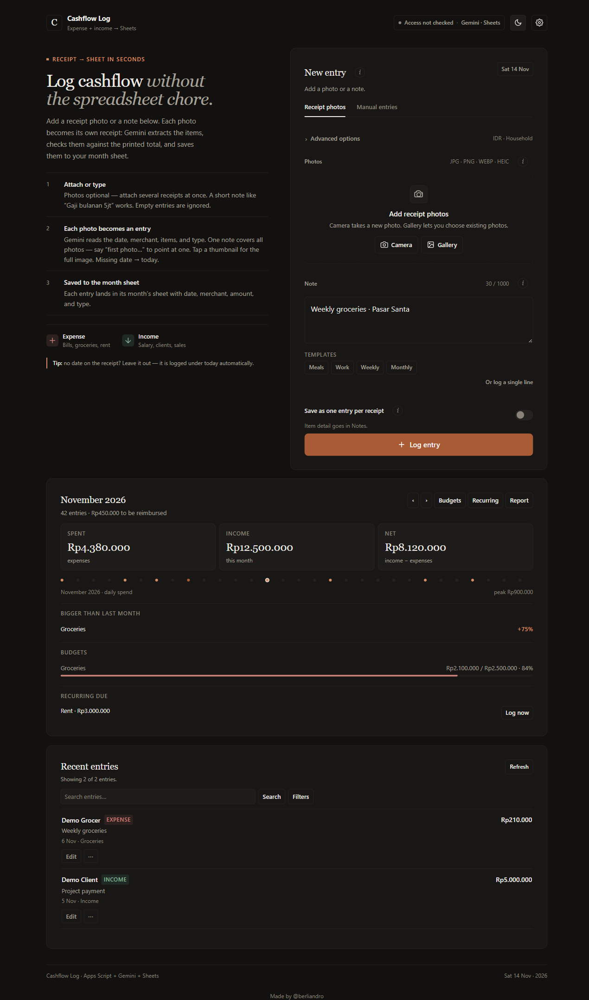
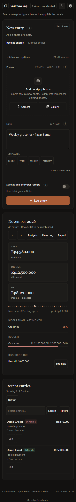

# Cashflow Log

Snap a receipt → Gemini structures it → rows land in Google Sheets. Self-hosted expense-and-income logging for individuals and families, running entirely on Google Apps Script + Google Sheets.

<p align="center">
  
  <br><em>Desktop preview</em>
</p>

<p align="center">
  
  <br><em>Mobile preview</em>
</p>

## Overview

Cashflow Log removes the spreadsheet chore from expense tracking. Photograph a receipt (or just type a note), and Gemini extracts the date, merchant, line items, and category. Each receipt is checked against its own printed total before anything is written, and every row lands in a monthly sheet with stable IDs. Mistakes are recoverable: deletions go to a hidden Trash sheet for 7 days instead of vanishing.

It is useful for anyone who already lives in Google Sheets and wants receipt logging without another paid service, another account, or data leaving their own Google account — plus a one-click Windows installer so non-technical family members can run their own copy.

- **One row per receipt** (Quick-Input only) — writes exactly one spreadsheet row per receipt at its verified signed total. The Description uses the receipt's own printed title when there is one, otherwise the item description, or `Merchant · Category (N items)`. Notes carry your shared note plus that receipt's own items, written as `Item ×qty @ unit price = line total` whenever the printed quantity and unit price were legible — and as `Item: line total` when they were not, so nothing is ever invented. Each receipt repeats your note but never mixes in another photo's items.

- **Receipt extraction** — Gemini reads dates, merchants, line items, categories, and Expense/Income type from JPG, PNG, WEBP, or HEIC photos; a typed note works with no photo at all.
- **Two-phase total reconciliation** — Phase 1 reads each photo's printed total, Phase 2 extracts every line item, and each receipt's item sum must match its printed total exactly.
- **Batched submission pipeline** — Table Layout rows (the default tab) grow dynamically with no row cap and submit as sequential bounded batches that split automatically when a batch is too large.
- **Repair and review handling** — Mismatches get a bounded repair pass (Quick-Input retries still-mismatched receipts up to two more times); unresolved rows stay in the app with their photos for review while valid rows are still logged. Nothing unverified is saved silently.
- **Force-save (Table Layout only)** (OFF by default) — after repair, adds one clearly labeled balancing line only when the printed total is readable. It handles either missing charges or missing discounts and records an audit note. With Force-save off, unresolved mismatches remain available for review. Quick-Input follows its fixed automatic reconciliation policy without exposing a toggle.
- **Transaction IDs** — Every receipt gets a unique `YYYYMMDD` + letter-sequence ID (e.g. `20261231AA`) shared by all its rows; month sheets sort chronologically with rows ordered by Transaction ID after clean reports.
- **Entry IDs** — Every line item carries a system-managed unique ID that survives sorting, deletion, and recovery. Both IDs are looked up by header name, never by column position.
- **Google Sheets integration** — Rows append to `MMMM yyyy` month sheets copied from an auto-created `Template`; missing system headers are migrated idempotently.
- **Recoverable Trash** — Deleted entries and whole receipts move to a hidden `_CF_Trash` sheet with typed payloads and deletion timestamps.
- **Seven-day retention** — Trash records expire strictly from the server deletion timestamp (7 × 24 h, whole transaction groups together), never from receipt dates.
- **Light default, dark mode included** — flat paper-white surfaces, editorial serif headings, small radii, compact controls, keyboard support, accessible information dialogs, and reduced-motion respect; the layout stays readable down to 320px.
- **Monthly overview** — spend, income, net, category totals, a 30/31-dot daily ledger, anomaly callouts, budget progress, and recurring items due.
- **Search, edit, and undo** — filter logs by text, type, category, member, or reimbursement; edit fields with an audit note; undo a delete from the toast while the record is still in Trash.
- **Drafts and offline capture** — notes, table rows, selected photos, and entry metadata autosave locally (IndexedDB for photos) and restore after a reload; offline submissions are queued and can be sent when the connection returns.
- **Duplicate and review gates** — a receipt fingerprint is checked against `_CF_ReceiptHashes`; possible repeats are held for review with an explicit “Allow duplicate” override. “Review before save” shows extracted totals and verdicts before writing.
- **Household, reimbursement, and budgets** — member attribution, reimbursable/reimbursed flags with filters, and monthly category limits with 80% alerts.
- **Multi-currency and splits** — each entry can carry a currency and rate; `Base Amount` keeps dashboard totals comparable. Tags are shared per entry, and Table Layout rows can be split across categories when the split sums to the verified total.
- **Reports, backup, and sessions** — monthly PDF reports in Drive, JSON backup/restore that only adds missing Entry IDs, optional receipt-image retention, and a server-side session list with revoke.

## How it works

1. Add rows in **Table Layout** (one photo + note + forced Expense/Income each) or use the **Quick-Input** tab, then submit. Quick-Input always force-saves (receipts that pass the check are logged at once; only unconfirmed photos stay), while Table Layout follows your own reconciliation toggles. Quick-Input's decision rule is the **printed final Total**, not how complete the line list looks. If that total is readable, the receipt is saved under it — even when the extractor flags the item list as possibly incomplete, in which case the gap is disclosed in that receipt's Notes and status line. A receipt is held back for review only when the total itself cannot be read reliably (missing, uncertain, or not visible), or when the total is readable but the items still do not reconcile after the bounded repair attempts. Table Layout keeps its stricter behaviour and still holds an incomplete line list back for review.
2. The app **plans** the submission, then runs **Phase 1** (printed totals) and **Phase 2** (line items) in sequential batches.
3. Rows are **triaged**: exact matches log immediately, mismatches get **one repair pass**, and leftovers wait for **review** with their photos.
4. **Commit** appends verified rows with stable Transaction and Entry IDs and records an idempotency ledger (`_CF_Submissions`), so retries never duplicate rows.
5. **Sorting** runs separately once the report has zero unresolved rows.
6. **Delete** moves rows to `_CF_Trash`; **Trash** in the Settings menu restores them with original IDs intact. Restores never overwrite live data.
7. The **overview** reads the selected month, its feature columns, budgets, recurring rules, and the previous month for anomaly comparison. Recent-log pages and overview reads are cached briefly and invalidated by writes.
8. **Feature data** lives in hidden system sheets: `_CF_Budgets`, `_CF_Recurring`, `_CF_Household`, `_CF_ReceiptHashes`, plus the new month-sheet columns (`Currency`, `FX Rate`, `Base Amount`, `Tags`, `Member`, `Reimbursable`, `Reimbursed`, `Receipt Hash`, `Receipt URL`, `Split Group`). Headers are added idempotently; existing columns never move.

## Getting started

### Prerequisites

- A Google account with access to Google Sheets and [Google AI Studio](https://aistudio.google.com/)
- A Gemini API key from AI Studio
- A Google Sheet (or let the app create the structure for you)
- For manual setup: Git, Node.js, and [`@google/clasp`](https://github.com/google/clasp) (`npm install -g @google/clasp`)

### Family install (Windows, easiest)

1. Run `Install and Tutorial Berliandro Cash Log.bat` once.
2. It downloads the latest `main` from `https://github.com/berliandro/expense-logger.git` and installs any missing Git / Node.js / clasp.
3. Enter your Google Apps Script ID when asked, then log in with Google when `clasp login` opens the browser.
4. The installer runs `clasp push -f`, creates the initial Web App deployment, validates the deployment ID, and saves it locally.
5. It shows your `https://script.google.com/macros/s/{DEPLOYMENT_ID}/exec` URL and opens it automatically.

### Manual setup (developers)

```sh
git clone https://github.com/berliandro/expense-logger.git
cd expense-logger
clasp login          # opens Google OAuth in your browser (auth stays local)
clasp push           # uploads Code.js, Index.html, the template partials, and appsscript.json
```

Then open the web-app `/exec` URL, set a 6-digit PIN on first run, and add the Gemini API key (Settings menu → Set API key) and Google Sheet (Settings menu → Set Sheet) when prompted. If the script was copied from an existing Sheet (container-bound), that sheet is used automatically.

## Configuration

Script Properties (**Project Settings → Script Properties** in the Apps Script editor) accept:

| Key              | Value                                                              |
|------------------|--------------------------------------------------------------------|
| `GEMINI_API_KEY` | Your Gemini key (AI Studio). Also settable in-app via Settings.    |
| `SPREADSHEET_ID` | Manual fallback for the sheet ID; the in-app Set Sheet prompt is preferred. |

No keys ever live in this repo — they stay in Script Properties, and the browser holds only a random session token (configurable lifetime, see below), never the PIN or keys.

Month sheets are created automatically from the hidden `Template` sheet with the base headers
`Date | Description | Amount | Category | Spending Type | Type | Merchant | Notes | Transaction ID | Entry ID`
plus the feature columns `Currency | FX Rate | Base Amount | Tags | Member | Reimbursable | Reimbursed | Receipt Hash | Receipt URL | Split Group`. Existing sheets receive missing headers at the end; no existing column is moved.
The app runs with timezone `Asia/Jakarta` (`appsscript.json`). Explicit OAuth scopes are declared for Sheets, `UrlFetchApp`/Gemini, Google Drive (optional receipt images and PDF reports), and `userinfo.email` (the conservative access status check). The web app executes as the deploying user while remaining openable by anyone with the link — the app's own PIN/session check still gates every sensitive call.

## Deleting and recovering entries

- In **Recent logs**, each card has a **Delete entry** action; the **⋯** menu offers **Delete entire receipt…**, showing merchant, date, Transaction ID, and the exact line-item count before you confirm. Records without a Transaction ID can only delete the single entry.
- Deleted rows move to the hidden `_CF_Trash` sheet and stay recoverable for **7 days from deletion**, then are removed automatically.
- Recover via Settings menu → **Trash** (with Entries and Transactions filters). Restored rows keep their original Entry and Transaction IDs; if an ID already exists live, the restore is blocked with an explanation instead of overwriting.
- Never edit the system-managed `Transaction ID` / `Entry ID` columns or the hidden `_CF_Submissions` / `_CF_Trash` sheets by hand — logs, delete/restore, and sorting all rely on them.

## Updates and deployment

Run `Update.bat` for later updates. It keeps the same Web App URL:

```text
Update.bat
→ temporary copy in %TEMP% (so Git can safely replace Update.bat itself)
→ git fetch origin main
→ git reset --hard origin/main (tracked files match GitHub exactly)
→ clasp push -f
→ clasp update-deployment {saved deployment ID}
→ show the same https://script.google.com/macros/s/{DEPLOYMENT_ID}/exec URL
```

Family installs are deployment clients: `reset --hard` overwrites local source changes, so commit anything you care about before updating. Per-user files (`.clasp.json`, `.cashlogger-deployment-id`) are untouched. For manual deploys:

```sh
# first time (creates a deployment and prints its deploymentId as JSON):
clasp create-deployment --description "Cashflow logger" --json
# afterwards (keep the same web-app URL / deployment ID):
clasp update-deployment <DEPLOYMENT_ID> -d "Describe the change"
```

## Tests

Run the source-contract, isolated reconciliation-policy, and design/performance guards with Node.js:

```sh
npm test
```

Or run the suites directly:

```sh
node tests/ui-polish.test.js
node tests/design-perf.test.js
node tests/features.test.js
node tests/backend-dashboard.test.js
```

`ui-polish.test.js` covers document structure, header/modal contracts, copy, tabs, legacy ledger idempotency, Quick-Input policy, and Force-save. `design-perf.test.js` guards the flat design (no blur or decorative gradients), the orange accent, system fonts, batched history rendering, cached image URLs, history-cache invalidation, and JavaScript syntax. `features.test.js` covers the manifest scopes, `cfApi` surface, layout/client feature surfaces, split math, currency metadata, month helpers, sessions, scan caps, backup/report/image hooks, and parses every backend module. `backend-dashboard.test.js` runs the dashboard/search functions against a mocked spreadsheet and checks totals, category grouping, budgets, anomalies, recurring due items, reimbursements, and filters. Browser layout and physical Android testing are reported separately when available.

## Performance and design notes

- **Flat surfaces, not glass.** There are no `backdrop-filter` layers and no decorative background gradients. The layout stays flat and light while borders, spacing, and type carry the hierarchy. Phones do not composite blur while scrolling.
- **System fonts only.** The external Google Fonts request was removed; first paint no longer waits on a third-party stylesheet or font files.
- **Recent-logs cache.** `getRecentLogs` caches the first pages in `CacheService` for 120 seconds. Every append, delete, restore, and re-sort bumps a version key, so a caller never reads a stale page after its own mutation.
- **Perceived latency.** The first history page preloads after unlock; cached pages reveal immediately, and later pages prefetch in the background.
- **Rendering.** History pages are inserted in one `insertAdjacentHTML` write, photo thumbnails reuse one object URL per file, and nonessential cloud preferences wait for the `cf:unlocked` event.
- **Measured locally.** Chromium emulating a 390×844 phone at 3× DPR, 8× CPU throttle, with 80 history rows: median 47.6 FPS during continuous scrolling over three runs, versus 14.0 FPS on the previous build. The structural change is 17 `backdrop-filter` declarations and 2 external font requests removed. This is browser emulation; physical Android testing remains a manual check.

## Troubleshooting

- `Google Sheet is not set` (or `Spreadsheet is not configured` / `Could not open the Google Sheet` / legacy `Invalid argument: id`) on Log entry means no usable sheet was found. Set it via Settings menu → Set Sheet (Sheet ID or full URL), or manually via `SPREADSHEET_ID` in Script Properties. Then reload the `/exec` URL and retry. A missing `Template` sheet is created automatically with the headers listed under Configuration.
- `Gemini API key is not set` means `GEMINI_API_KEY` is missing in Script Properties or was never saved via Settings menu → Set API key. Add it, then retry.
- `Too many PIN attempts - try again later` means 5 wrong PINs within 10 minutes; wait for the window to pass.
- A restore that reports a missing month sheet recreates it from the `Template` automatically; restores that cannot determine a destination refuse with an explanation and leave the Trash record untouched.

## Security and privacy

- The raw PIN is never stored on the device and is never accepted by sensitive backend calls — login exchanges it for a random 256-bit session token, stored hashed server-side. Wrong PINs are rate-limited (5 fails / 10 min).
- Session lifetime is globally configurable (Settings menu → Session settings): whole hours from 1 to 168, default 3 hours, with activity-based renewal ON by default. New durations apply to sessions created afterward; current sessions keep their recorded expiry. When renewal is off and 30 minutes or less remain, the header pill shows a countdown; at 10 minutes a warning appears. Expiry locks the app back behind the PIN gate without reloading, so typed notes, table rows, and selected photos are preserved.
- `PIN_HASH` / `PIN_SALT` / hashed sessions live in Script Properties.
- Receipt photos are sent to Gemini for extraction and are never stored in the Trash ledger or logs beyond the review flow; financial rows live only in your own Google Sheet.
- `.clasp.json` (Script ID binding), `.clasprc.json` (personal clasp OAuth tokens), `.cashlogger-deployment-id` (Web App deployment ID), and `.opencode/` (agent session state) are git-ignored — never commit them.

### Deployment visibility (read-only, verified)

The header pill reports the deployment's access state **only when the server can positively prove it**. A running Apps Script cannot read a deployment's access setting (there is no getter for it, and `appsscript.json` only describes *new* deployments), so the pill is conservative by design — it shows `Access unknown` far more often than `Public`:

| Pill shows | When the server proves it |
|---|---|
| **Public** (green dot) | **Only** when the active user is positively identified as a *different* account than the deploying owner. A verified non-owner who can execute this endpoint proves the deployment is not owner-only. |
| **Private** (red dot) | **Never from this endpoint.** Nothing inside a running script can verify an owner-only deployment, so this state is never shown. |
| **Access unknown** (grey dot) | Everything else — the caller is the deploying owner, the caller carries **no identity** (the app runs in a sandboxed iframe, so the Google session may not propagate; a blank email proves nothing), the owner identity could not be read, or the identity API failed. |

So with the normal anonymous/public deployment most users will see **Access unknown**, which is the honest answer: the app cannot tell you who else can open it. Ask the owner, or check *Deploy → Manage deployments*. No email address, token, or owner credential is ever sent to the browser — only a boolean and a source label.

**There is deliberately no visibility toggle in Settings.** Changing Google deployment access needs an owner OAuth token with the `script.deployments` scope, which must never be sent to a browser or stored in this app; Apps Script also exposes no API to read or write an existing deployment's access mode. Shipping a switch that could not be owner-authorized would let anyone who knows the family PIN lock every other user out.

**Manual process (owner only):** Apps Script editor → **Deploy → Manage deployments →** edit the deployment → *Who has access* → save. This creates a new version on the **same deployment ID**, so the `/exec` URL keeps working. Note *Private/MYSELF* immediately stops other family members from opening the app; the owner re-opens it with their own Google account. Keep the previous version noted in Manage deployments for rollback.

## Project layout

| Path | Purpose |
|------|---------|
| `Code.js` | Apps Script entry point: `doGet`, template includes, legacy entry wrappers |
| `BackendConfig.js` | Constants, Gemini schemas, prompts, batch budgets, spreadsheet access |
| `BackendAuth.js` | PIN, sessions/metadata, access status, Gemini key, hero preference |
| `BackendHistory.js` | Recent-log reads, scan measurement/cap, page cache |
| `BackendGemini.js` | Gemini calls and the two-phase extract/repair pipeline |
| `BackendSheets.js` | Month sheets, IDs, ledger, Trash, commit, append |
| `BackendSort.js` | Month-sheet ordering |
| `BackendFeatures.js` | Session-gated `cfApi`: dashboard, search, edit, budgets, recurring, household, backup, reports, images, duplicates |
| `Index.html` | Thin template shell; composes the partials below with `HtmlService` includes |
| `Styles.html` | Flat light/dark design system: paper surfaces, orange accent, serif display type, small radii |
| `Layout.html` | Body markup: top bar, entry panel, dashboard, history, dialogs |
| `AppCore.html` | Shared client helpers, photo previews, lightboxes, submission engine |
| `AppEntry.html` | Table Layout rows and batch submission |
| `AppAuth.html` | PIN gate, session UI, configuration dialogs, Trash, Recent Logs |
| `AppFeatures.html` | Dashboard, budgets, recurring, household, sessions, backup, edit, search, drafts/offline, review |
| `appsscript.json` | Timezone, runtime, explicit OAuth scopes, web-app access settings |
| `docs/screenshots/` | Desktop and mobile product screenshots shown above |
| `docs/feature-backlog.md` | Prioritized product and reliability backlog |
| `tests/` | Source contracts, design/performance guards, and isolated feature tests |
| `Install and Tutorial Berliandro Cash Log.bat` | Family Windows installer |
| `Update.bat` | Updater that preserves the Web App URL |

There is no build step: `clasp push` uploads all `.js` backend modules, the HTML partials, and `appsscript.json` directly. `Index.html` is evaluated as an Apps Script template, so the partials are composed at serve time.

Product ideas and the suggested next milestone are in [`docs/feature-backlog.md`](docs/feature-backlog.md).
