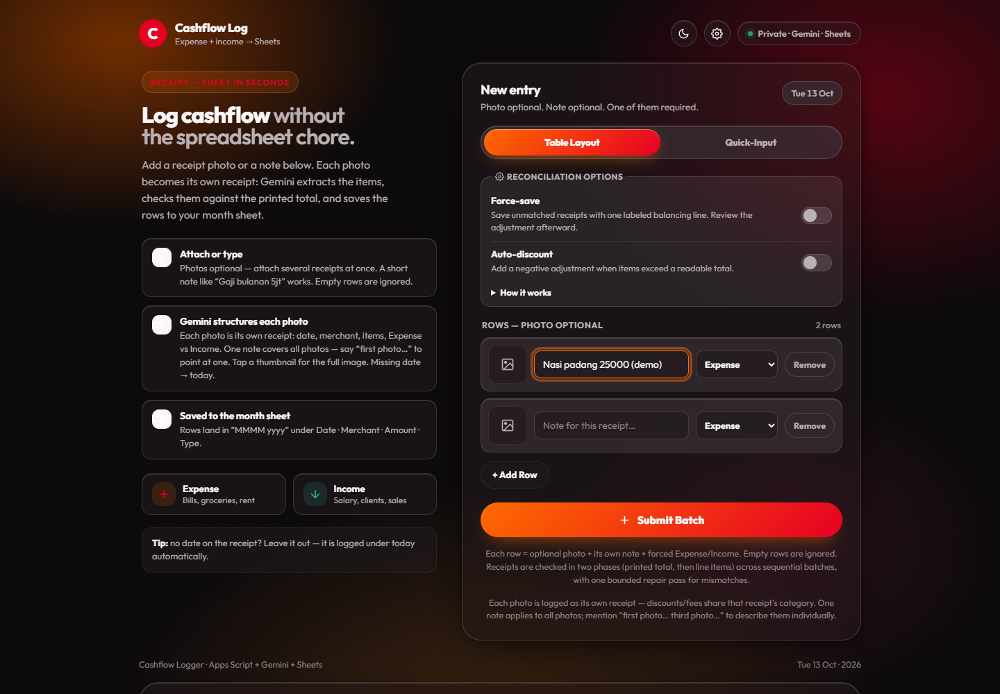
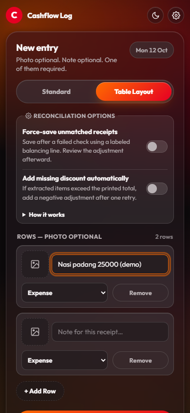

# Cashflow Log

Snap a receipt → Gemini structures it → rows land in Google Sheets. Self-hosted expense-and-income logging for individuals and families, running entirely on Google Apps Script + Google Sheets.

<p align="center">
  
  <br><em>Desktop preview</em>
</p>

<p align="center">
  
  <br><em>Mobile preview</em>
</p>

## Overview

Cashflow Log removes the spreadsheet chore from expense tracking. Photograph a receipt (or just type a note), and Gemini extracts the date, merchant, line items, and category. Each receipt is checked against its own printed total before anything is written, and every row lands in a monthly sheet with stable IDs. Mistakes are recoverable: deletions go to a hidden Trash sheet for 7 days instead of vanishing.

It is useful for anyone who already lives in Google Sheets and wants receipt logging without another paid service, another account, or data leaving their own Google account — plus a one-click Windows installer so non-technical family members can run their own copy.

- **One row per receipt** (Quick-Input only) — writes exactly one spreadsheet row per receipt at its verified signed total. The Description uses the receipt's own printed title when there is one, otherwise the item description, or `Merchant · Category (N items)`. Notes carry your shared note plus that receipt's own items, written as `Item ×qty @ unit price = line total` whenever the printed quantity and unit price were legible — and as `Item: line total` when they were not, so nothing is ever invented. Each receipt repeats your note but never mixes in another photo's items.
- **Optional balancing rules**

- **Receipt extraction** — Gemini reads dates, merchants, line items, categories, and Expense/Income type from JPG, PNG, WEBP, or HEIC photos; a typed note works with no photo at all.
- **Two-phase total reconciliation** — Phase 1 reads each photo's printed total, Phase 2 extracts every line item, and each receipt's item sum must match its printed total exactly.
- **Batched submission pipeline** — Table Layout rows (the default tab) grow dynamically with no row cap and submit as sequential bounded batches that split automatically when a batch is too large.
- **Repair and review handling** — Mismatches get a bounded repair pass (Quick-Input retries still-mismatched receipts up to two more times); unresolved rows stay in the app with their photos for review while valid rows are still logged. Nothing unverified is saved silently.
- **Optional balancing rules** (both OFF by default) — **Force-save** adds one labeled balancing line after a failed check; **Auto-discount** adds only a negative adjustment when items exceed a readable printed total. Turning Force-save on visibly suspends auto-discount without losing your choice.
- **Transaction IDs** — Every receipt gets a unique `YYYYMMDD` + letter-sequence ID (e.g. `20261231AA`) shared by all its rows; month sheets sort chronologically with rows ordered by Transaction ID after clean reports.
- **Entry IDs** — Every line item carries a system-managed unique ID that survives sorting, deletion, and recovery. Both IDs are looked up by header name, never by column position.
- **Google Sheets integration** — Rows append to `MMMM yyyy` month sheets copied from an auto-created `Template`; missing system headers are migrated idempotently.
- **Recoverable Trash** — Deleted entries and whole receipts move to a hidden `_CF_Trash` sheet with typed payloads and deletion timestamps.
- **Seven-day retention** — Trash records expire strictly from the server deletion timestamp (7 × 24 h, whole transaction groups together), never from receipt dates.
- **Desktop and mobile UI** — Dark default with light mode, compact switch controls, keyboard support, and reduced-motion respect; the layout stays readable down to narrow phone screens.

## How it works

1. Add rows in **Table Layout** (one photo + note + forced Expense/Income each) or use the **Quick-Input** tab, then submit. Quick-Input always force-saves (receipts that pass the check are logged at once; only unconfirmed photos stay), while Table Layout follows your own reconciliation toggles. Quick-Input's decision rule is the **printed final Total**, not how complete the line list looks. If that total is readable, the receipt is saved under it — even when the extractor flags the item list as possibly incomplete, in which case the gap is disclosed in that receipt's Notes and status line. A receipt is held back for review only when the total itself cannot be read reliably (missing, uncertain, or not visible), or when the total is readable but the items still do not reconcile after the bounded repair attempts. Table Layout keeps its stricter behaviour and still holds an incomplete line list back for review.
2. The app **plans** the submission, then runs **Phase 1** (printed totals) and **Phase 2** (line items) in sequential batches.
3. Rows are **triaged**: exact matches log immediately, mismatches get **one repair pass**, and leftovers wait for **review** with their photos.
4. **Commit** appends verified rows with stable Transaction and Entry IDs and records an idempotency ledger (`_CF_Submissions`), so retries never duplicate rows.
5. **Sorting** runs separately once the report has zero unresolved rows.
6. **Delete** moves rows to `_CF_Trash`; **Trash** in the Settings menu restores them with original IDs intact. Restores never overwrite live data.

## Getting started

### Prerequisites

- A Google account with access to Google Sheets and [Google AI Studio](https://aistudio.google.com/)
- A Gemini API key from AI Studio
- A Google Sheet (or let the app create the structure for you)
- For manual setup: Git, Node.js, and [`@google/clasp`](https://github.com/google/clasp) (`npm install -g @google/clasp`)

### Family install (Windows, easiest)

1. Run `Install and Tutorial Berliandro Cash Log.bat` once.
2. It downloads the latest `main` from `https://github.com/berliandro/expense-logger.git` and installs any missing Git / Node.js / clasp.
3. Enter your Google Apps Script ID when asked, then log in with Google when `clasp login` opens the browser.
4. The installer runs `clasp push -f`, creates the initial Web App deployment, validates the deployment ID, and saves it locally.
5. It shows your `https://script.google.com/macros/s/{DEPLOYMENT_ID}/exec` URL and opens it automatically.

### Manual setup (developers)

```sh
git clone https://github.com/berliandro/expense-logger.git
cd expense-logger
clasp login          # opens Google OAuth in your browser (auth stays local)
clasp push           # uploads Code.js + Index.html + appsscript.json
```

Then open the web-app `/exec` URL, set a 6-digit PIN on first run, and add the Gemini API key (Settings menu → Set API key) and Google Sheet (Settings menu → Set Sheet) when prompted. If the script was copied from an existing Sheet (container-bound), that sheet is used automatically.

## Configuration

Script Properties (**Project Settings → Script Properties** in the Apps Script editor) accept:

| Key              | Value                                                              |
|------------------|--------------------------------------------------------------------|
| `GEMINI_API_KEY` | Your Gemini key (AI Studio). Also settable in-app via Settings.    |
| `SPREADSHEET_ID` | Manual fallback for the sheet ID; the in-app Set Sheet prompt is preferred. |

No keys ever live in this repo — they stay in Script Properties, and the browser holds only a random session token (configurable lifetime, see below), never the PIN or keys.

Month sheets are created automatically from the hidden `Template` sheet with headers
`Date | Description | Amount | Category | Spending Type | Type | Merchant | Notes | Transaction ID | Entry ID`.
The app runs with timezone `Asia/Jakarta` (`appsscript.json`), and the web app executes as the deploying user while remaining openable by anyone with the link — the app's own PIN/session check still gates every sensitive call.

## Deleting and recovering entries

- In **Recent logs**, each card has a **Delete entry** action; the **⋯** menu offers **Delete entire receipt…**, showing merchant, date, Transaction ID, and the exact line-item count before you confirm. Records without a Transaction ID can only delete the single entry.
- Deleted rows move to the hidden `_CF_Trash` sheet and stay recoverable for **7 days from deletion**, then are removed automatically.
- Recover via Settings menu → **Trash** (with Entries and Transactions filters). Restored rows keep their original Entry and Transaction IDs; if an ID already exists live, the restore is blocked with an explanation instead of overwriting.
- Never edit the system-managed `Transaction ID` / `Entry ID` columns or the hidden `_CF_Submissions` / `_CF_Trash` sheets by hand — logs, delete/restore, and sorting all rely on them.

## Updates and deployment

Run `Update.bat` for later updates. It keeps the same Web App URL:

```text
Update.bat
→ temporary copy in %TEMP% (so Git can safely replace Update.bat itself)
→ git fetch origin main
→ git reset --hard origin/main (tracked files match GitHub exactly)
→ clasp push -f
→ clasp update-deployment {saved deployment ID}
→ show the same https://script.google.com/macros/s/{DEPLOYMENT_ID}/exec URL
```

Family installs are deployment clients: `reset --hard` overwrites local source changes, so commit anything you care about before updating. Per-user files (`.clasp.json`, `.cashlogger-deployment-id`) are untouched. For manual deploys:

```sh
# first time (creates a deployment and prints its deploymentId as JSON):
clasp create-deployment --description "Cashflow logger" --json
# afterwards (keep the same web-app URL / deployment ID):
clasp update-deployment <DEPLOYMENT_ID> -d "Describe the change"
```

## Troubleshooting

- `Google Sheet is not set` (or `Spreadsheet is not configured` / `Could not open the Google Sheet` / legacy `Invalid argument: id`) on Log entry means no usable sheet was found. Set it via Settings menu → Set Sheet (Sheet ID or full URL), or manually via `SPREADSHEET_ID` in Script Properties. Then reload the `/exec` URL and retry. A missing `Template` sheet is created automatically with the headers listed under Configuration.
- `Gemini API key is not set` means `GEMINI_API_KEY` is missing in Script Properties or was never saved via Settings menu → Set API key. Add it, then retry.
- `Too many PIN attempts - try again later` means 5 wrong PINs within 10 minutes; wait for the window to pass.
- A restore that reports a missing month sheet recreates it from the `Template` automatically; restores that cannot determine a destination refuse with an explanation and leave the Trash record untouched.

## Security and privacy

- The raw PIN is never stored on the device and is never accepted by sensitive backend calls — login exchanges it for a random 256-bit session token, stored hashed server-side. Wrong PINs are rate-limited (5 fails / 10 min).
- Session lifetime is globally configurable (Settings menu → Session settings): whole hours from 1 to 168, default 3 hours, with activity-based renewal ON by default. New durations apply to sessions created afterward; current sessions keep their recorded expiry. When renewal is off and 30 minutes or less remain, the header pill shows a countdown; at 10 minutes a warning appears. Expiry locks the app back behind the PIN gate without reloading, so typed notes, table rows, and selected photos are preserved.
- `PIN_HASH` / `PIN_SALT` / hashed sessions live in Script Properties.
- Receipt photos are sent to Gemini for extraction and are never stored in the Trash ledger or logs beyond the review flow; financial rows live only in your own Google Sheet.
- `.clasp.json` (Script ID binding), `.clasprc.json` (personal clasp OAuth tokens), `.cashlogger-deployment-id` (Web App deployment ID), and `.opencode/` (agent session state) are git-ignored — never commit them.

### Deployment visibility (read-only, verified)

The header pill reports the deployment's access state **only after the server proves it**, and it never claims *Private* unless the server actually verified an owner-only deployment:

| Pill shows | When |
|---|---|
| **Public** (green dot) | Your request reached the script with no verified owner identity. An owner-only (MYSELF) deployment blocks non-owners before the script runs, so this proves the deployment is reachable by non-owners. |
| **Private** (red dot) | Only if the server verified an owner-only deployment. Nothing inside a running script can currently verify this, so this state is normally never shown. |
| **Access unknown** (grey dot) | Signed in as the deploying owner, or the check failed. Visibility is genuinely unknown, not silently assumed. |

**There is deliberately no visibility toggle in Settings.** Changing Google deployment access needs an owner OAuth token with the `script.deployments` scope, which must never be sent to a browser or stored in this app; Apps Script also exposes no API to read or write an existing deployment's access mode. Shipping a switch that could not be owner-authorized would let anyone who knows the family PIN lock every other user out.

**Manual process (owner only):** Apps Script editor → **Deploy → Manage deployments →** edit the deployment → *Who has access* → save. This creates a new version on the **same deployment ID**, so the `/exec` URL keeps working. Note *Private/MYSELF* immediately stops other family members from opening the app; the owner re-opens it with their own Google account. Keep the previous version noted in Manage deployments for rollback.

## Project layout

| Path | Purpose |
|------|---------|
| `Code.js` | Apps Script backend: serves the page, calls Gemini, writes Sheets, owns Trash/IDs/sort |
| `Index.html` | Single-page frontend (dark default + light mode, Table Layout + Quick-Input tabs) |
| `appsscript.json` | Timezone, runtime, and web-app access settings |
| `docs/screenshots/` | Desktop and mobile product screenshots shown above |
| `Install and Tutorial Berliandro Cash Log.bat` | Family Windows installer |
| `Update.bat` | Updater that preserves the Web App URL |

There is no build step and no test runner shipped in the repo — `Code.js` and `Index.html` deploy directly with `clasp push`.
